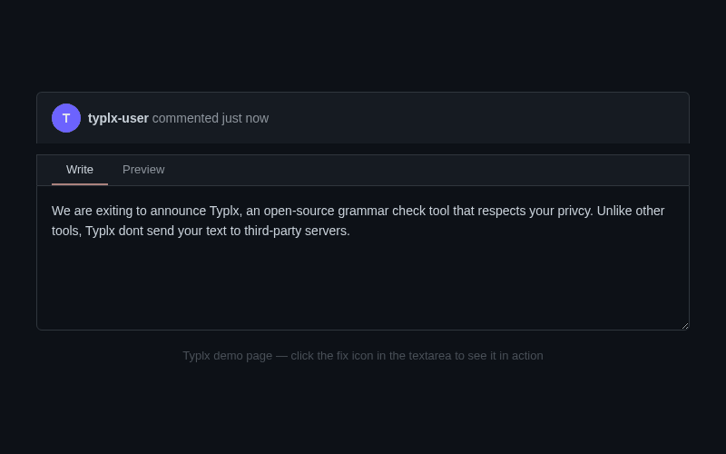

# Typlx — Privacy-First AI Grammar Checker for Browser

> AI-powered grammar and writing corrections for every text field in your browser. **Your text never passes through Typlx servers.**

[](LICENSE)
[](https://github.com/typlx/chrome-grammar-fix-extension/actions/workflows/ci.yml)
[](CONTRIBUTING.md)

Typlx connects your browser directly to the LLM of your choice — OpenAI, Anthropic Claude, Google Gemini, or a fully local model via Ollama. You own the API key. You choose the model. Typlx is just the interface.

**→ [Join the Typlx Pro waitlist](https://typlx.com/pro)** — early-bird pricing locked in for waitlist members.



## Install

Build from source in three steps:

```bash
git clone https://github.com/typlx/chrome-grammar-fix-extension.git
cd chrome-grammar-fix-extension
npm install --include=dev && npm run build
```

Then load the unpacked extension:

- **Chrome / Edge**: `chrome://extensions` → Developer mode → Load unpacked → select `dist/chrome/`
- **Firefox**: `about:debugging` → Load Temporary Add-on → select `dist/firefox/manifest.json`

> Firefox extension listing coming soon. Android and iOS keyboard apps are also [open source](https://github.com/typlx).

## Why Typlx?

|                            | Typlx               | Grammarly | LanguageTool                       |
| -------------------------- | ------------------- | --------- | ---------------------------------- |
| Price                      | Free                | $12–30/mo | Free–$6.99/mo                      |
| Your text on their servers | ❌ Never            | ✅ Always | ✅ Default (self-host for privacy) |
| Open source                | ✅ MIT              | ❌        | ✅ Partial                         |
| AI-quality corrections     | ✅                  | ✅        | ❌                                 |
| Local model support        | ✅ Ollama/LM Studio | ❌        | ❌                                 |
| Account required           | ❌                  | ✅        | ✅                                 |

## Supported Models

- **OpenAI** — GPT-4o, GPT-4o mini, GPT-3.5
- **Anthropic** — Claude Haiku, Sonnet, Opus
- **Google** — Gemini Flash, Gemini Pro
- **Local** — Any Ollama or LM Studio model (fully offline, no API key)

## Configure

1. Click the Typlx icon in the toolbar.
2. Select your LLM provider (OpenAI-compatible or Anthropic Claude).
3. Enter your API URL, model, and token.
4. Click **Save Settings**.

## Usage

1. Focus any text field on any page.
2. Click the fix icon in the field's bottom-right corner.
3. Wait for the correction (a spinner shows progress).
4. Done — your text is replaced with the corrected version.

Typlx works with `textarea`, `input[type="text" | "search" | "email" | "url"]`, and `contenteditable` elements. It handles dynamic/SPA pages automatically.

## Supported Providers

| Provider              | Endpoints Used                          |
| --------------------- | --------------------------------------- |
| **OpenAI-compatible** | `GET /models`, `POST /chat/completions` |
| **Anthropic Claude**  | Native Anthropic Messages API           |

Any API that implements the OpenAI chat completions interface works — including local model servers like Ollama, LM Studio, and vLLM.

## Security

- API tokens are **encrypted at rest** (AES-GCM with PBKDF2 key derivation) in `chrome.storage.local`.
- Tokens are only used in the background service worker — never exposed to content scripts or page context.
- No telemetry, no analytics, no phone-home behavior.

## Project Structure

```text
manifest.json              # Chrome manifest
manifest.firefox.json      # Firefox manifest (gecko settings, background scripts)
background/
  service-worker.js
  providers/
    anthropic-provider.js
    openai-provider.js
    provider-registry.js
content/
  content.js          # injected into pages (IIFE, shadow DOM)
  content-core.js     # testable pure functions
  content.css
popup/
  popup.html / popup.css / popup.js
utils/
  crypto.js           # AES-GCM token encryption
  storage.js          # Chrome storage wrapper
icons/
```

## Contributing

Contributions welcome. See [CONTRIBUTING.md](CONTRIBUTING.md) for setup, code quality tools (ESLint, Prettier, Vitest), and workflow.

## Documentation

- [User Guide](USERGUIDE.md)
- [Contributing Guide](CONTRIBUTING.md)
- [Release Notes](RELEASE_NOTES.md)
- [Privacy Policy](PRIVACY_POLICY.md)

## Related Projects

| Repo                                                                                | Platform                    |
| ----------------------------------------------------------------------------------- | --------------------------- |
| [typlx/android-grammar-keyboard](https://github.com/typlx/android-grammar-keyboard) | Android custom IME keyboard |
| [typlx/ios-grammar-keyboard](https://github.com/typlx/ios-grammar-keyboard)         | iOS keyboard extension      |
| [typlx/typlx-website](https://github.com/typlx/typlx-website)                       | typlx.com website           |

## License

MIT. See [LICENSE](LICENSE) for details.
